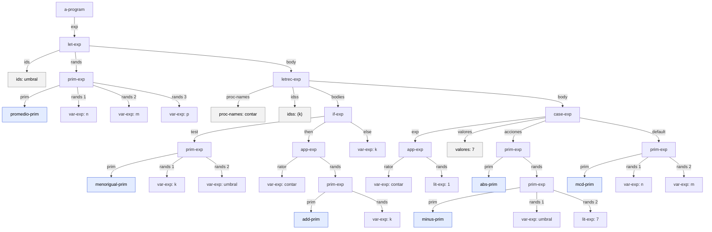
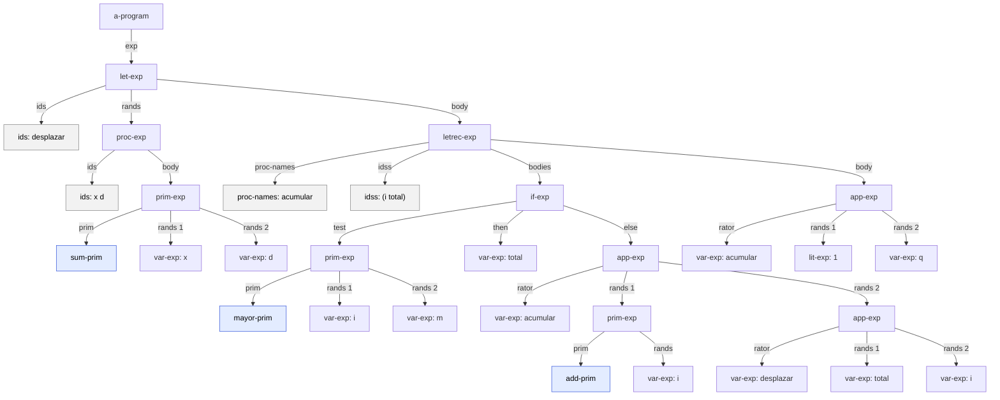
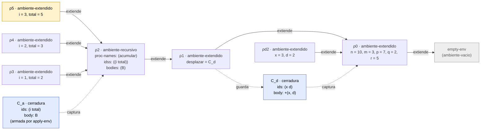

# Informe de AST — Taller 2: el intérprete de Cauca

**Curso:** Fundamentos de Interpretación y Compilación de Lenguajes
de Programación — Universidad del Valle, Sede Tuluá.

**Integrantes del grupo:**

| Nombre                     | Código  | Correo institucional               |
| -------------------------- | ------- | ---------------------------------- |
| Luis David Mendoza Manzano | 2067621 | mendoza.luis@correounivalle.edu.co |

---

## 1. Gramática considerada

Esta es la gramática BNF de Cauca completa (Partes 1 a 4). Debajo de
cada producción va, en la segunda línea, el constructor del datatype que
SLLGEN genera para ella con `sllgen:make-define-datatypes`.

```bnf
<programa>    ::= <expresion>
                   a-program(exp)

<expresion>   ::= <numero>
                   lit-exp(dato)
              ::= <identificador>
                   var-exp(id)
              ::= "true"
                   true-exp()
              ::= "false"
                   false-exp()
              ::= <primitiva> "(" {<expresion>}*(,) ")"
                   prim-exp(prim, rands)
              ::= "if" <expresion> "then" <expresion> "else" <expresion> "end"
                   if-exp(test, true-exp, false-exp)
              ::= "let" {<identificador> "=" <expresion>}* "in" <expresion> "end"
                   let-exp(ids, rands, body)
              ::= "proc" "(" {<identificador>}*(,) ")" <expresion> "end"
                   proc-exp(ids, body)
              ::= "apply" <expresion> "(" {<expresion>}*(,) ")"
                   app-exp(rator, rands)
              ::= "letrec" {<identificador> "(" {<identificador>}*(,) ")"
                            "=" <expresion>}* "in" <expresion> "end"
                   letrec-exp(proc-names, idss, bodies, body)
              ::= "case" <expresion> {"of" <numero> "=>" <expresion>}+
                  "otherwise" "=>" <expresion> "end"
                   case-exp(exp, valores, acciones, default)

<primitiva>   ::= "+"         sum-prim()          ::= "abs"      abs-prim()
              ::= "-"         minus-prim()        ::= "mcd"      mcd-prim()
              ::= "*"         mult-prim()         ::= "mcm"      mcm-prim()
              ::= "/"         div-prim()          ::= "promedio" promedio-prim()
              ::= "add1"      add-prim()          ::= "xor"      xor-prim()
              ::= "sub1"      sub-prim()          ::= "implica"  implica-prim()
              ::= ">"         mayor-prim()        ::= "entre"    entre-prim()
              ::= ">="        mayorigual-prim()
              ::= "<"         menor-prim()
              ::= "<="        menorigual-prim()
              ::= "=="        igual-prim()
              ::= "not"       not-prim()
              ::= "and"       and-prim()
              ::= "or"        or-prim()
```

Así se realiza cada no terminal en el código:

| No terminal         | Datatype    | Variantes                                                                                                                       | Campos                                                          | Módulo                  |
| ------------------- | ----------- | ------------------------------------------------------------------------------------------------------------------------------- | --------------------------------------------------------------- | ----------------------- |
| `<programa>`        | `programa`  | `a-program`                                                                                                                     | `exp`                                                           | `sintaxis.rkt` (SLLGEN) |
| `<expresion>`       | `expresion` | `lit-exp`, `var-exp`, `true-exp`, `false-exp`, `prim-exp`, `if-exp`, `let-exp`, `proc-exp`, `app-exp`, `letrec-exp`, `case-exp` | los de la gramática de arriba                                   | `sintaxis.rkt` (SLLGEN) |
| `<primitiva>`       | `primitiva` | las 21 variantes `*-prim`, sin campos                                                                                           | ninguno                                                         | `sintaxis.rkt` (SLLGEN) |
| valor procedimiento | `procval`   | `cerradura`                                                                                                                     | `ids`, `body`, `env`                                            | `valores.rkt`           |
| ambiente            | `ambiente`  | `ambiente-vacio`, `ambiente-extendido`, `ambiente-recursivo`                                                                    | `ids`, `valores`, `env` / `proc-names`, `idss`, `bodies`, `env` | `ambiente.rkt`          |

Los AST solo usan los tres primeros datatypes, que son los que produce el
parser. `procval` y `ambiente` aparecen en la traza de la sección 3,
porque son lo que el intérprete construye al evaluar el árbol.

---

## 2. Ejemplos de AST

> **Cómo leer los diagramas.** Cada nodo lleva el nombre del constructor
> del AST. Las hojas `var-exp` y `lit-exp` llevan además su dato. Las
> aristas llevan el nombre del campo por el que se baja. Donde un campo es
> una lista de expresiones (`rands`), cada elemento sale con su posición
> (`rands 1`, `rands 2`, ...). Donde el campo es una lista de símbolos o
> de números (`ids`, `idss`, `proc-names`, `valores`), la lista aparece
> como un nodo gris, porque SLLGEN la entrega como lista de Racket y no
> como variante del datatype. Los nodos azules son las variantes de
> `primitiva`.

### Ejemplo 1 — el programa de la Parte 5.1: `let`, `letrec`, `case`, `app-exp` y primitivas

**Expresión concreta:**

```text
let umbral = promedio(n, m, p)
in
  letrec
    contar (k) = if <=(k, umbral)
                 then apply contar (add1(k))
                 else k
                 end
  in
    case apply contar (1)
      of 7 => abs(-(umbral, 7))
      otherwise => mcd(n, m)
    end
  end
end
```

**AST:**



**Explicación:** La raíz es `a-program`, que envuelve la expresión. La
expresión es un `let-exp` con una sola ligadura: `ids` es la lista
`(umbral)` y `rands` tiene un único elemento, el `prim-exp` de
`promedio-prim` con tres `var-exp`. Su `body` es el `letrec-exp`, que
guarda tres listas paralelas: `proc-names = (contar)`, `idss = ((k))`
(una lista de parámetros por procedimiento) y `bodies`, con el cuerpo de
`contar` sin evaluar. Ese cuerpo es un `if-exp`: el `test` es el `prim-exp`
de `menorigual-prim`, la rama `then` es un `app-exp` cuyo `rator` es
`var-exp: contar` y cuyo único operando es `add1(k)`, y la rama `else` es
`var-exp: k`. El `body` del `letrec-exp` es un `case-exp` con cuatro
campos: `exp`, que es otro `app-exp` (el control se evalúa una sola vez);
`valores`, la lista `(7)` de literales; `acciones`, la lista con el
`prim-exp` de `abs`, que contiene a su vez la resta `-(umbral, 7)`; y
`default`, la rama `otherwise`, el `prim-exp` de `mcd`. Nótese que el
literal `7` de la rama `of` es un número crudo (`<numero>`) y no un
`lit-exp`, mientras que el `7` de `-(umbral, 7)` sí es un `lit-exp`:
la gramática pide un `<numero>` en el `of` y una `<expresion>` en un
operando.

---

### Ejemplo 2 — el programa de la traza (Parte 5.2): `proc`, `apply` anidado y `letrec`

Este es el árbol que recorre la traza de la sección 3, así que conviene
tenerlo a la vista.

**Expresión concreta:**

```text
let desplazar = proc (x, d) +(x, d) end
in
  letrec
    acumular (i, total) = if >(i, m)
                          then total
                          else apply acumular
                                 (add1(i), apply desplazar (total, i))
                          end
  in
    apply acumular (1, q)
  end
end
```

**AST:**



**Explicación:** La ligadura del `let-exp` no es un valor sino un
`proc-exp` con `ids = (x d)` y como cuerpo el `prim-exp` de `sum-prim`.
En el árbol el procedimiento es solo eso, un nodo; la clausura aparece
cuando el intérprete evalúa ese nodo. El `body` del `letrec-exp` es el
`app-exp` de `acumular` con dos operandos, `lit-exp: 1` y `var-exp: q`. El
cuerpo de `acumular` (`bodies`) es el `if-exp`: su rama `else` es un
`app-exp` en el que el segundo operando es a su vez otro `app-exp`
(`apply desplazar (total, i)`). Esa anidación es la que obliga a
la traza a evaluar los operandos de izquierda a derecha y a crear primero
el ambiente de `desplazar` y después el de la siguiente llamada a
`acumular`.

---

## 3. Traza de evaluación

**Expresión a evaluar:** el programa del Ejemplo 2.

**Ambiente inicial:**
$\rho_0 = [\,n = 10,\ m = 3,\ p = 7,\ q = 2,\ r = 5\,]$, que extiende al
ambiente vacío (`ambiente-vacio`).

### 3.1 Notación

- $[\,x_1 = v_1, \ldots\,]\rho$ es `ambiente-extendido` con esas
  ligaduras sobre $\rho$. Lo que la clase llama _extender un ambiente_.
- $\mathrm{C_d} = \texttt{cerradura}((x\ d),\ \texttt{+(x, d)},\ \rho_0)$ es
  la clausura de `desplazar`.
- $B$ es el cuerpo de `acumular`:
  `if >(i, m) then total else apply acumular (add1(i), apply desplazar (total, i)) end`.
- $\mathrm{C_a} = \texttt{cerradura}((i\ total),\ B,\ \rho_2)$ es la clausura
  de `acumular`. No se guarda en ningún ambiente: `apply-env` la **fabrica
  cada vez** que se busca el nombre `acumular`, con $\rho_2$ como ambiente.
- $\rho_2$ es un `ambiente-recursivo`. Se escribe
  $\rho_2 = \mathrm{rec}\big((\textit{acumular}),\ ((i\ total)),\ (B),\ \rho_1\big)$.
- Un ambiente se crea en tres momentos (clase 6): después del `in` de un
  `let`, después del `in` de un `letrec` y al invocar un procedimiento.

### 3.2 Pasos

1. $\text{value-of}(E_0,\ \rho_0)$, donde $E_0$ es el programa completo.
   Es un `let-exp` con `ids = (desplazar)`.
   - 1.1 $\text{value-of}(\texttt{proc (x, d) +(x, d) end},\ \rho_0) \to \mathrm{C_d}$.
     Un `proc-exp` solo construye la clausura; **no evalúa el cuerpo** y
     guarda $\rho_0$, el ambiente vigente.
   - 1.2 Se crea $\rho_1 = [\,\textit{desplazar} = \mathrm{C_d}\,]\rho_0$.
   - 1.3 $\text{value-of}(E_1,\ \rho_1)$, con $E_1$ el `letrec-exp`.

2. $\text{value-of}(E_1,\ \rho_1)$. Un `letrec-exp` no evalúa nada: arma
   $\rho_2 = \mathrm{rec}\big((\textit{acumular}),\ ((i\ total)),\ (B),\ \rho_1\big)$
   y evalúa su cuerpo en él:
   $\text{value-of}(\texttt{apply acumular (1, q)},\ \rho_2)$.

3. $\text{value-of}(\texttt{apply acumular (1, q)},\ \rho_2)$, un `app-exp`.
   - 3.1 Operador: $\text{value-of}(\texttt{acumular},\ \rho_2) =
     \texttt{apply-env}(\rho_2, \textit{acumular})$. $\rho_2$ declara ese
     nombre, así que se fabrica $\mathrm{C_a}$ con ambiente $\rho_2$.
     `procval?` es verdadero.
   - 3.2 Operandos, de izquierda a derecha:
     $\text{value-of}(\texttt{1},\ \rho_2) \to 1$ y
     $\text{value-of}(\texttt{q},\ \rho_2) \to 2$ (no está en $\rho_2$ ni
     en $\rho_1$; se encuentra en $\rho_0$).
   - 3.3 $\texttt{apply-procedure}(\mathrm{C_a},\ (1\ 2))$: dos parámetros y
     dos argumentos. Se crea
     $\rho_3 = [\,i = 1,\ total = 2\,]\rho_2$ y se evalúa
     $\text{value-of}(B,\ \rho_3)$.

4. $\text{value-of}(B,\ \rho_3)$, un `if-exp`.
   - 4.1 Prueba: $\text{value-of}(\texttt{>(i, m)},\ \rho_3)$. `i` $= 1$ en
     $\rho_3$; `m` no está en $\rho_3$, ni en $\rho_2$ (solo declara
     `acumular`), ni en $\rho_1$; en $\rho_0$ vale $3$. Resultado
     $\texttt{>(1, 3)} \to \texttt{\#f}$. Es booleano, se toma la rama
     `else`. El `if` no crea ambiente.
   - 4.2 Operador: $\mathrm{C_a}$ (otra vez fabricada desde $\rho_2$).
   - 4.3 Primer operando: $\text{value-of}(\texttt{add1(i)},\ \rho_3) \to 2$.
   - 4.4 Segundo operando:
     $\text{value-of}(\texttt{apply desplazar (total, i)},\ \rho_3)$.
     Operador: `desplazar` se busca en $\rho_3$, $\rho_2$ y se encuentra en
     $\rho_1$: $\mathrm{C_d}$. Operandos: `total` $\to 2$, `i` $\to 1$.
     $\texttt{apply-procedure}(\mathrm{C_d},\ (2\ 1))$ crea
     $\rho_{d1} = [\,x = 2,\ d = 1\,]\rho_0$ (el ambiente de la **clausura**,
     no $\rho_3$) y $\text{value-of}(\texttt{+(x, d)},\ \rho_{d1}) \to 3$.
   - 4.5 **Primera llamada recursiva:**
     $\texttt{apply-procedure}(\mathrm{C_a},\ (2\ 3))$ crea
     $\rho_4 = [\,i = 2,\ total = 3\,]\rho_2$.

5. $\text{value-of}(B,\ \rho_4)$: $\texttt{>(2, 3)} \to \texttt{\#f}$.
   `add1(i)` $\to 3$. $\texttt{apply desplazar (total, i)}$ con
   $\rho_{d2} = [\,x = 3,\ d = 2\,]\rho_0$ da $5$.
   **Segunda llamada recursiva:**
   $\texttt{apply-procedure}(\mathrm{C_a},\ (3\ 5))$ crea
   $\rho_5 = [\,i = 3,\ total = 5\,]\rho_2$.
   **En este momento se dibuja la cadena de ambientes (sección 3.3).**

6. $\text{value-of}(B,\ \rho_5)$: $\texttt{>(3, 3)} \to \texttt{\#f}$.
   `add1(i)` $\to 4$. $\texttt{apply desplazar (total, i)}$ con
   $\rho_{d3} = [\,x = 5,\ d = 3\,]\rho_0$ da $8$. Tercera llamada
   recursiva: $\rho_6 = [\,i = 4,\ total = 8\,]\rho_2$.

7. $\text{value-of}(B,\ \rho_6)$: $\texttt{>(4, 3)} \to \texttt{\#t}$, rama
   `then`: $\text{value-of}(\texttt{total},\ \rho_6) \to 8$. Es el caso base:
   no hay más llamadas.

8. El valor sube por las cuatro aplicaciones de `acumular`, porque cada una
   devuelve directamente lo que devuelve su cuerpo, y por el `letrec` y el
   `let`, que devuelven el valor de su cuerpo:

   $$
   \text{value-of}(E_0,\ \rho_0) = 8
   $$

**Cuenta de lo que hizo el programa** (se puede comprobar contra la regla
de los tres momentos): 4 aplicaciones de `acumular` ($\rho_3$ a $\rho_6$),
3 de `desplazar` ($\rho_{d1}$ a $\rho_{d3}$), 1 `let` ($\rho_1$) y 1 `letrec`
($\rho_2$), o sea **9 ambientes** nuevos además de $\rho_0$.

### 3.3 Cadena de ambientes en la segunda llamada recursiva

La cadena del ambiente de la llamada actual es
$\rho_5 \to \rho_2 \to \rho_1 \to \rho_0 \to \texttt{empty-env}$. Las flechas
continuas van del ambiente que extiende al ambiente extendido. Las
discontinuas no son extensión: marcan **qué ambiente captura** cada
clausura. $\rho_3$ y $\rho_4$ siguen vivos (sus llamadas esperan el
resultado de la siguiente) y, como los de $\rho_5$, **cuelgan todos del
mismo $\rho_2$**: ninguna llamada cuelga de la que la produjo. $\rho_{d2}$
es el ambiente de la llamada a `desplazar` que produjo el argumento $5$,
y cuelga de $\rho_0$, el ambiente de su clausura, no de $\rho_3$ ni de
$\rho_4$.



**Lectura de la cadena.** Para resolver `m` desde el cuerpo de `acumular`
se recorre $\rho_5$ (no está), $\rho_2$ (no es `acumular`), $\rho_1$ (no es
`desplazar`) y se encuentra en $\rho_0$. Para resolver `acumular` se
recorre $\rho_5$ y se llega a $\rho_2$, que sí lo declara: ahí
`apply-env` fabrica $\mathrm{C_a}$ con $\rho_2$ como ambiente, y por eso
el cuerpo, al ejecutarse, vuelve a encontrar el nombre de su propio
procedimiento. Para `desplazar` se llega a $\rho_1$, que guarda
$\mathrm{C_d}$; la clausura captura $\rho_0$, de modo que su cuerpo
`+(x, d)` solo ve `x`, `d` y las cinco variables iniciales.

---

## 4. Estado del almacén en una transacción

No aplica en este taller. Cauca todavía no tiene almacén, asignación ni
bloques `atomic`: los ambientes solo ligan nombres a valores y no hay
nada que escribir ni que revertir.

---

## 5. Referencias

- Friedman, D. P., & Wand, M. _Essentials of Programming Languages_,
  3.ª ed., MIT Press, 2008. Sección 2.5 (árboles de sintaxis abstracta),
  sección 3.2 (el lenguaje LET y ambientes), sección 3.3 (procedimientos y
  clausuras) y sección 3.4 (procedimientos recursivos, figura 3.9).
- Notas de clase: Clase 3 (datatypes y AST), Clase 5 (clausuras y alcance
  estático) y Clase 6 (`letrec` y ambiente recursivo).
- Documentación de diagramas Mermaid en GitHub.
  <https://docs.github.com/en/get-started/writing-on-github/working-with-advanced-formatting/creating-diagrams>
