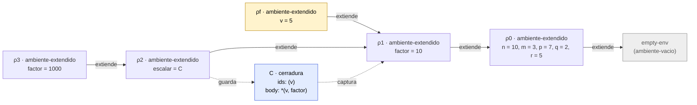
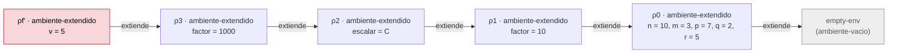

# Informe de corrección — Taller 2: el intérprete de Cauca

**Curso:** Fundamentos de Interpretación y Compilación de Lenguajes
de Programación — Universidad del Valle, Sede Tuluá.

**Integrantes del grupo:**

| Nombre                     | Código  | Correo institucional               |
| -------------------------- | ------- | ---------------------------------- |
| Luis David Mendoza Manzano | 2067621 | mendoza.luis@correounivalle.edu.co |

---

## 1. Marco formal

### 1.1 Corrección de programas recursivos

Sea $f : A \to B$ una función y $A$ un conjunto definido
recursivamente. Sea $P_f$ un programa recursivo en Racket que
pretende calcular $f$. Decimos que $P_f$ es correcto con respecto a
su especificación si se cumple:

$$
\forall a \in A \,:\, P_f(a) = f(a)
$$

La estrategia de demostración es la **inducción estructural**
sobre $A$:

- **Caso base:** para cada valor básico $a_0 \in A$ se verifica
  $P_f(a_0) = f(a_0)$.
- **Caso inductivo:** asumiendo la **hipótesis de inducción**
  $P_f(a') = f(a')$ para las subestructuras $a'$ que forman $a$, se
  demuestra $P_f(a) = f(a)$.

**Notación.** $\text{value-of}(e,\rho)$ es el resultado de
`(evaluar-expresion e ρ)`; escribimos $\text{value-of}(e,\rho) = \mathsf{err}$
cuando el programa termina levantando `eopl:error`. $\langle\rangle$ es
la lista vacía y $x::xs$ es una lista con cabeza $x$ y cola $xs$.
$[\,x_1 = v_1,\ \ldots,\ x_n = v_n\,]\sigma$ es
`(ambiente-extendido '(x1 ... xn) (list v1 ... vn) σ)`, y
$\mathrm{rec}(N, I, B)\,\sigma$ es
`(ambiente-recursivo N I B σ)`, con $N$ los nombres, $I$ las listas de
parámetros y $B$ los cuerpos sin evaluar. $\varnothing$ es
`(ambiente-vacio)`.

### 1.2 Corrección de programas iterativos

No hay programas iterativos con acumulador en las funciones analizadas.
`buscar-proc` (dentro de `apply-env`) y `elegir-rama` recorren una lista
con recursión estructural sobre su cola, de modo que bastan el esquema
de la sección 1.1 y una medida decreciente para la terminación; no hay
estado que se acumule ni invariante de acumulador que enunciar. (La
invariante que sí se enuncia, la de la ligadura recursiva, es una
propiedad del ambiente, no de un acumulador, y está en la sección 2.2.)

### 1.3 La búsqueda en el ambiente

Las tres demostraciones usan lo que hace `apply-env`. Se enuncia una sola
vez. Escribimos $\text{lookup}(\rho, y)$ para `(apply-env ρ 'y)`. Del
código (sección 2.2) salen estas ecuaciones:

$$
\begin{aligned}
\text{lookup}(\varnothing,\ y) &= \mathsf{err} \\[2pt]
\text{lookup}([\,x_1 = v_1,\ldots,x_n = v_n\,]\sigma,\ y) &=
\begin{cases}
v_i & \text{si } i \text{ es el menor índice con } x_i = y\\
\text{lookup}(\sigma,\ y) & \text{si } y \notin \{x_1,\ldots,x_n\}
\end{cases}\\[2pt]
\text{lookup}(\mathrm{rec}(N,I,B)\,\sigma,\ y) &=
\begin{cases}
\texttt{cerradura}(I_j,\ B_j,\ \mathrm{rec}(N,I,B)\,\sigma) & \text{si } j \text{ es el menor índice con } N_j = y\\
\text{lookup}(\sigma,\ y) & \text{si } y \notin N
\end{cases}
\end{aligned}
$$

**Lema L1 (la búsqueda cumple esas ecuaciones).**

_Demostración._ Por inducción sobre el número de eslabones de la cadena
$\rho$ y, dentro de un eslabón, sobre la longitud de la lista que se
recorre.

- **Caso base** ($\rho = \varnothing$): la rama `ambiente-vacio` levanta
  `eopl:error`. Es la primera ecuación.
- **Eslabón `ambiente-extendido`:** `buscar-valor` recibe `ids` y
  `valores`. Si `ids` es vacía, delega en `(apply-env old-env id)`, que por
  hipótesis de inducción sobre la cadena es $\text{lookup}(\sigma, y)$. Si
  `(car ids)` es `id`, devuelve `(car valores)`, el valor del primer
  índice que coincide. Si no, se llama a sí misma con `(cdr ids)` y
  `(cdr valores)`: la lista decrece en uno, y por hipótesis de inducción
  sobre la longitud devuelve el valor del menor índice que coincide en la
  cola, o delega. Como el índice de la cola es el índice original menos
  uno, la respuesta es la del menor índice global.
- **Eslabón `ambiente-recursivo`:** el mismo argumento con `buscar-proc`,
  con una diferencia: al coincidir el nombre devuelve
  `(cerradura (car idss) (car bodies) env)`, donde `env` es el
  **ambiente recursivo completo** que `apply-env` recibió como primer
  argumento, no `old-env`. $\square$

**Lema L2 (extender no cambia las otras variables).**
Si $y \notin \{x_1,\ldots,x_n\}$, entonces
$\text{lookup}([\,x_1 = v_1,\ldots,x_n = v_n\,]\sigma,\ y) = \text{lookup}(\sigma, y)$.

_Demostración._ Es el segundo caso de la ecuación del eslabón extendido
(L1). $\square$

---

## 2. Funciones analizadas

### 2.1 Corrección de `apply-procedure`

**Especificación.**

- **Tipo:** `apply-procedure : procval × lista de valores -> valor`.
- **Pre-condición:** $\text{Pre}(p, \vec{a}) \equiv p = \texttt{cerradura}(\vec{x}, B, \sigma)$
  con $\vec{x} = (x_1,\ldots,x_n)$ parámetros, $B$ una expresión y
  $\sigma$ el ambiente donde se definió el procedimiento, y $\vec{a}$ la
  lista de valores de los argumentos, ya evaluados.
- **Post-condición:**

$$
\text{Post}(p, \vec{a}, r) \equiv
\begin{cases}
r = \text{value-of}\big(B,\ [\,x_1 = a_1,\ldots,x_n = a_n\,]\sigma\big) & \text{si } |\vec{x}| = |\vec{a}|\\
r = \mathsf{err} \text{ sin evaluar } B & \text{si } |\vec{x}| \neq |\vec{a}|
\end{cases}
$$

El ambiente de la llamada **no** aparece: la post-condición no
depende de él.

**Código.**

```racket
;; apply-procedure : procval x lista de valores -> valor
;; Verifica que la cantidad de argumentos coincida con la de parámetros
;; y evalúa el cuerpo en el ambiente de la clausura extendido con las
;; ligaduras de los parámetros, no en el ambiente de la llamada. Levanta
;; eopl:error si las cantidades no coinciden.
;; Ejemplo: aplicar la clausura de proc (x) add1(x) end a la lista (4)
;;   => 5
(define apply-procedure
  (lambda (proc args)
    (cases procval proc
      (cerradura (ids body env)
        (if (= (length ids) (length args))
            (evaluar-expresion body (ambiente-extendido ids args env))
            (eopl:error 'apply-procedure
                        "El procedimiento espera ~s argumentos y recibio ~s"
                        (length ids) (length args)))))))
```

La aplicación completa, que incluye la verificación del operador, es la
cláusula `app-exp` de `evaluar-expresion`:

```racket
(app-exp (rator rands)
  (let ((proc (evaluar-expresion rator env)))
    (if (procval? proc)
        (apply-procedure proc (evaluar-rands rands env))
        (eopl:error 'app-exp
                    "Se intento aplicar algo que no es un procedimiento: ~s"
                    proc))))
```

**Demostración.**

_(a) El cuerpo se evalúa en el ambiente de la clausura extendido con los
parámetros, y no en el de la llamada._

La demostración usa un hecho de alcance, no de recursión: la función
recibe solo `(proc args)`. **`apply-procedure` no tiene acceso al ambiente
de la llamada**: el ambiente de quien llama es la variable `env` de la
cláusula `app-exp`, y no se le pasa. El único ambiente a su alcance es el
que `cases` extrae de la clausura, tercer campo de `cerradura`, que es
$\sigma$. Por tanto, el único ambiente sobre el que puede construir el del
cuerpo es $\sigma$.

El caso inductivo de la lista $\vec{x}$ no es necesario: la función no
recorre nada, solo compara longitudes. Se analiza por casos sobre la
comparación:

- **$|\vec{x}| = |\vec{a}|$.** El `if` toma la rama verdadera y evalúa
  `(evaluar-expresion body (ambiente-extendido ids args env))`, donde,
  por el patrón `(cerradura (ids body env) ...)`, $ids = \vec{x}$,
  $body = B$ y $env = \sigma$. Es exactamente
  $\text{value-of}(B,\ [\,\vec{x} = \vec{a}\,]\sigma)$. ✓

**Consecuencia (variables libres).** Sea $y$ una variable que ocurre en
$B$ y no es parámetro. Por L2,
$\text{lookup}([\,\vec{x} = \vec{a}\,]\sigma,\ y) = \text{lookup}(\sigma, y)$:
su valor sale de $\sigma$, el ambiente donde nació el procedimiento. Eso
es el **alcance estático**. Y como la post-condición no menciona el
ambiente de la llamada, dos llamadas con los mismos argumentos desde
ambientes distintos dan el mismo resultado.

_(b) El ejemplo de contraste._

```text
let factor = 10
in
  let escalar = proc (v) *(v, factor) end
  in
    let factor = 1000
    in
      apply escalar (5)
    end
  end
end
```

Se parte del ambiente inicial
$\rho_0 = [\,n = 10,\ m = 3,\ p = 7,\ q = 2,\ r = 5\,]\varnothing$. Los
ambientes que se crean son:

- $\rho_1 = [\,\textit{factor} = 10\,]\rho_0$, después del primer `in`.
- $C = \texttt{cerradura}((v),\ \texttt{*(v, factor)},\ \rho_1)$, que
  `proc` construye al evaluarse en $\rho_1$: guarda $\rho_1$, el ambiente
  vigente. El cuerpo no se evalúa.
- $\rho_2 = [\,\textit{escalar} = C\,]\rho_1$, después del segundo `in`.
- $\rho_3 = [\,\textit{factor} = 1000\,]\rho_2$, después del tercero.

La llamada `apply escalar (5)` se evalúa en $\rho_3$. El operador se busca
y da $C$ (se encuentra en $\rho_2$; $\rho_3$ solo liga `factor`). El
argumento es $5$. Ahora hay dos ambientes posibles para el cuerpo:

$$
\begin{aligned}
\textbf{Correcto (nuestro intérprete):}\quad &
\rho_f = [\,v = 5\,]\rho_1
&&\Rightarrow\ \text{lookup}(\rho_f, \textit{factor}) = 10
&&\Rightarrow\ \texttt{*(5, 10)} = \mathbf{50}\\
\textbf{Dinámico (el que se evita):}\quad &
\rho_f' = [\,v = 5\,]\rho_3
&&\Rightarrow\ \text{lookup}(\rho_f', \textit{factor}) = 1000
&&\Rightarrow\ \texttt{*(5, 1000)} = \mathbf{5000}
\end{aligned}
$$

La cadena del cuerpo en el intérprete correcto. $\rho_f$ extiende a
$\rho_1$ (el de la clausura); $\rho_3$ y $\rho_2$ existen, pero **no
están en la cadena**:



La cadena de la versión con alcance dinámico, que da $5000$.
$\rho_f'$ extiende a $\rho_3$, el ambiente de la llamada, y al buscar
`factor` se encuentra primero el $1000$:



Lo que distingue las dos cadenas es una sola cosa: de qué ambiente
cuelga el eslabón de los parámetros. Nuestro código usa el tercer campo
de la clausura, y por (a) no puede usar otro; por eso el programa da
$50$ y no $5000$.

_(c) El error se levanta exactamente cuando el operador no es un
procedimiento o cuando la cantidad de argumentos no coincide._

Sea $v$ el valor del operador, $\vec{a}$ el de los argumentos. El
`app-exp` evalúa el operador, y se distingue:

1. **$v$ no es `procval`.** La rama `else` del `if (procval? proc)`
   levanta `eopl:error`, y lo hace **antes** de evaluar los operandos.
   Como no se llega a `apply-procedure`, no se evalúa ningún cuerpo.
   Ejemplo: `apply 5 (1)` levanta
   `app-exp: Se intento aplicar algo que no es un procedimiento: 5`.
2. **$v$ es `procval` y $|\vec{x}| \neq |\vec{a}|$.** `apply-procedure`
   toma la rama `else` del `if (= (length ids) (length args))` y levanta
   `eopl:error`, sin evaluar el cuerpo. Ejemplo:
   `let f = proc (a, b) +(a, b) end in apply f (1) end` levanta
   `apply-procedure: El procedimiento espera 2 argumentos y recibio 1`.
3. **$v$ es `procval` y $|\vec{x}| = |\vec{a}|$.** No se toma ninguna de
   las dos ramas de error: se evalúa el cuerpo como en (a).

Los tres casos son exhaustivos y excluyentes, y los errores de la
aplicación solo salen de 1 y de 2. Por tanto, _la aplicación misma_
levanta error si y solo si el operador no es un procedimiento o las
cantidades no coinciden. (Cualquier otro error que aparezca viene de
evaluar el operador, los operandos o el cuerpo: son errores de esas
expresiones y no de la aplicación.)

**Terminación de `apply-procedure`.** Hace un número finito de pasos
antes de delegar: `length` sobre dos listas finitas y una construcción de
ambiente. La terminación de la llamada completa depende de que termine la
evaluación del cuerpo; con `letrec` un programa puede no terminar, y eso
no es un defecto de `apply-procedure` (véase 2.2, punto 4, para la
medida del ejemplo de `potencia`).

**Conclusión:** `apply-procedure` satisface $\text{Post}$: evalúa el
cuerpo en el ambiente de la clausura extendido con los parámetros,
independientemente del ambiente de la llamada, y levanta error en los dos
casos previstos y solo en ellos. $\blacksquare$

---

### 2.2 Corrección de la ligadura recursiva (`letrec`)

**Especificación.**

- **Tipo:** `letrec-exp : proc-names × idss × bodies × body × ambiente -> valor`
  (cláusula de `evaluar-expresion`).
- **Pre-condición:** los nombres $N = (f_1,\ldots,f_k)$ son distintos; $I$ y
  $B$ tienen $k$ elementos; $\rho$ es el ambiente de la expresión.
- **Post-condición:**
  $\text{value-of}(\texttt{letrec-exp}(N, I, B, e),\ \rho) = \text{value-of}(e,\ \rho_{\mathrm{rec}})$
  con $\rho_{\mathrm{rec}} = \mathrm{rec}(N, I, B)\,\rho$, y cada
  procedimiento $f_j$ se ejecuta con el invariante de abajo.

**Código.**

```racket
(letrec-exp (proc-names idss bodies letrec-body)
  (evaluar-expresion letrec-body
                     (ambiente-recursivo proc-names idss bodies env)))
```

```racket
;; apply-env : ambiente x symbol -> valor
;; Busca el identificador en el ambiente, respetando el shadowing de las
;; ligaduras más recientes, y levanta eopl:error si no está ligado.
;; En un ambiente-extendido devuelve el valor guardado. En un
;; ambiente-recursivo, si el nombre es uno de los declarados, arma en ese
;; momento una cerradura cuyo ambiente es el propio ambiente-recursivo;
;; si no, sigue por el ambiente que extiende.
;; Ejemplo: (apply-env (ambiente-inicial) 'n) => 10
(define apply-env
  (lambda (env id)
    (cases ambiente env
      (ambiente-vacio ()
        (eopl:error 'apply-env "La variable ~s no esta ligada" id))
      (ambiente-extendido (ids valores old-env)
        (letrec ((buscar-valor
                  (lambda (ids valores)
                    (cond
                      ((null? ids) (apply-env old-env id))
                      ((equal? (car ids) id) (car valores))
                      (else (buscar-valor (cdr ids) (cdr valores)))))))
          (buscar-valor ids valores)))
      (ambiente-recursivo (proc-names idss bodies old-env)
        (letrec ((buscar-proc
                  (lambda (proc-names idss bodies)
                    (cond
                      ((null? proc-names) (apply-env old-env id))
                      ((equal? (car proc-names) id)
                       (cerradura (car idss) (car bodies) env))
                      (else (buscar-proc (cdr proc-names)
                                         (cdr idss)
                                         (cdr bodies)))))))
          (buscar-proc proc-names idss bodies))))))
```

**1. Invariante.** Se enuncia la propiedad que debe cumplir el ambiente en
el que se evalúa el cuerpo de un procedimiento declarado con `letrec`.

> **INV.** Sea $\rho_{\mathrm{rec}} = \mathrm{rec}(N, I, B)\,\rho$. Cuando
> se evalúa el cuerpo $B_j$ de $f_j$, el ambiente es de la forma
> $E = [\,I_j = \vec{a}\,]\rho_{\mathrm{rec}}$, y para todo nombre
> $f_i \in N$ **que no sea parámetro de $f_j$**:
>
> $$
> \text{lookup}(E,\ f_i) = \texttt{cerradura}(I_i,\ B_i,\ \rho_{\mathrm{rec}}).
> $$
>
> Es decir, el cuerpo de cada procedimiento ve a **todos** los
> procedimientos del mismo `letrec`, incluido él mismo, y cada uno de
> ellos lleva a su vez como ambiente al mismo $\rho_{\mathrm{rec}}$.

**2. `apply-env` sobre un `ambiente-recursivo` construye una cerradura que
satisface el invariante.**

Sea $y = f_j$ el nombre buscado, con $j$ el menor índice tal que
$N_j = y$. Por L1, `buscar-proc` recorre `proc-names`, `idss` y `bodies`
al tiempo. Se demuestra por inducción sobre la longitud de la lista
`proc-names` que, si $y \in N$, devuelve
$\texttt{cerradura}(I_j, B_j, \rho_{\mathrm{rec}})$.

- **Caso base** (`proc-names` vacía): $y \notin N$. Delega en
  `(apply-env old-env id)`, que es $\text{lookup}(\rho, y)$. No se
  construye ninguna cerradura; es el caso de una variable que no es
  procedimiento del `letrec`.
- **Caso inductivo** (`proc-names` $= f::fs$): si
  $f = y$, devuelve `(cerradura (car idss) (car bodies) env)`, y `env` es
  el argumento de `apply-env`, o sea $\rho_{\mathrm{rec}}$ completo (no
  `old-env`). Si $f \neq y$, llama a `buscar-proc` con las tres colas, y
  por hipótesis de inducción sobre la longitud devuelve la cerradura del
  menor índice que coincide en la cola, que es el mismo $j$.

Por tanto $\text{lookup}(\rho_{\mathrm{rec}}, f_j) =
\texttt{cerradura}(I_j, B_j, \rho_{\mathrm{rec}})$.

**INV se cumple por inducción sobre la profundidad de las llamadas.**

- **Base: la primera llamada, hecha desde el cuerpo del `letrec`.** El
  cuerpo $e$ se evalúa en $\rho_{\mathrm{rec}}$. Una referencia a $f_i$
  evalúa `apply-env` sobre $\rho_{\mathrm{rec}}$ (o sobre una extensión
  suya con `let` o `proc`, que por L2 no cambia el resultado si $f_i$ no
  se vuelve a ligar) y obtiene
  $\texttt{cerradura}(I_i, B_i, \rho_{\mathrm{rec}})$. Al aplicarla,
  `apply-procedure` evalúa $B_i$ en
  $[\,I_i = \vec{a}\,]\rho_{\mathrm{rec}}$, que es la forma $E$ de INV.
- **Paso: una llamada hecha desde el cuerpo de otra.** Si el cuerpo de
  $f_j$ se evalúa en $E = [\,I_j = \vec{a}\,]\rho_{\mathrm{rec}}$ (hipótesis
  de inducción), una referencia a $f_i \notin I_j$ sigue por $E$: el
  eslabón de parámetros no lo liga, así que por L2 el resultado es
  $\text{lookup}(\rho_{\mathrm{rec}}, f_i)$, que es la cerradura de arriba.
  Al aplicarla, el nuevo cuerpo se evalúa en
  $[\,I_i = \vec{b}\,]\rho_{\mathrm{rec}}$: otra vez la forma $E$, con el
  mismo $\rho_{\mathrm{rec}}$. Ningún eslabón de una llamada cuelga de
  otra llamada: todos cuelgan del marco recursivo.

Si un parámetro de $f_j$ se llama como un procedimiento del `letrec`, el
parámetro tapa al procedimiento dentro de ese cuerpo; es el
_shadowing_ habitual (sección 3), y por eso INV se enuncia para los
nombres que no son parámetro. $\square$

**3. Por qué la misma declaración escrita con `let` no satisface el
invariante, y qué error produce.**

Se intenta definir el factorial con `let`:

```text
let fact = proc (n) if ==(n, 0) then 1 else *(n, apply fact (sub1(n))) end end
in apply fact (5) end
```

La regla de `let-exp` evalúa las partes derechas **en el ambiente actual**
$\rho_0$, antes de extender. Por eso el `proc` se evalúa en $\rho_0$ y
produce $C = \texttt{cerradura}((n),\ B,\ \rho_0)$, y recién después se
crea $\rho_1 = [\,\textit{fact} = C\,]\rho_0$. La cerradura guarda
$\rho_0$, no $\rho_1$. Al ejecutar `apply fact (5)` el cuerpo se evalúa en
$E = [\,n = 5\,]\rho_0$, y la referencia a `fact` hace

$$
\text{lookup}(E,\ \textit{fact})
= \text{lookup}(\rho_0,\ \textit{fact}) = \mathsf{err}
$$

porque `fact` no está ligada en $\rho_0$ (L2, y L1 llega hasta
`ambiente-vacio`). El error concreto que produce el intérprete es
`apply-env: La variable fact no esta ligada`.

No es una casualidad de este ejemplo. Para que el invariante valiera con
`let`, la cerradura de $f$ tendría que guardar un ambiente que ya contiene
a $f$, pero ese ambiente es el que se construye **después** de la
cerradura y con ella: cada uno necesita al otro, y con datos que no se
modifican no se pueden tener ambos a la vez. Por eso el `letrec` aplaza
la fabricación de la cerradura hasta que alguien busca el nombre: el
ambiente recursivo guarda con qué se fabrica ($N$, $I$, $B$), no la
cerradura, y `apply-env` la arma con el propio ambiente recursivo ya
existente.

La recursión mutua con dos `letrec` anidados falla por la misma razón. En

```text
letrec par (n) = if ==(n, 0) then 1 else apply impar (sub1(n)) end
in letrec impar (n) = if ==(n, 0) then 0 else apply par (sub1(n)) end
   in apply par (7) end
end
```

la cerradura de `par` captura su propio marco, donde solo está `par`:
`impar` se declara en un marco posterior que la cerradura nunca vio, y el
intérprete responde `apply-env: La variable impar no esta ligada`. En el
mismo `letrec`, $N = (\textit{par}, \textit{impar})$ y las dos cerraduras
capturan el mismo $\rho_{\mathrm{rec}}$, así que cada una encuentra a la
otra.

**4. Terminación y valor del ejemplo de `potencia`.**

```text
letrec
  potencia (base, exp) = if ==(exp, 0)
                         then 1
                         else *(base, apply potencia (base, sub1(exp)))
                         end
in
  apply potencia (2, 10)
end
```

_Pre-condición:_ `exp` es un entero no negativo. (Con `exp` negativo o no
entero la recursión nunca llega a $0$ y no termina; el `letrec` no lo
impide, y es responsabilidad del programa.)

_Medida:_ $\mu(\textit{exp}) = \textit{exp} \in \mathbb{N}$. En la rama
`else` la llamada recursiva se hace con `sub1(exp)`, así que
$\mu$ baja en exactamente uno. En el caso base, `exp` $= 0$, no hay
llamada. Como $\mathbb{N}$ no tiene cadenas decrecientes infinitas, la
recursión termina. Para `exp` $= 10$ son **11 aplicaciones**, con
`exp` $= 10, 9, \ldots, 0$, y cada una crea su ambiente
$[\,\textit{base} = 2,\ \textit{exp} = e\,]\rho_{\mathrm{rec}}$ colgando del
mismo marco recursivo.

_Valor:_ se demuestra por inducción sobre $e$ que
$\textit{potencia}(b, e) = b^e$.

- **Base** ($e = 0$): el `if` devuelve $1 = b^0$.
- **Paso** ($e = k + 1$): la llamada es `*(base, apply potencia (base, sub1(exp)))`
  con `sub1(exp)` $= k$. Por hipótesis de inducción
  $\textit{potencia}(b, k) = b^k$, así que el resultado es
  $b \cdot b^k = b^{k+1}$.

Con $b = 2$ y $e = 10$: $2^{10} = 1024$, como confirma la prueba
"el ejemplo de potencia". Y la búsqueda de `potencia` en cada ambiente
llega a $\rho_{\mathrm{rec}}$ (INV), por eso la llamada recursiva
encuentra el procedimiento. $\blacksquare$

---

### 2.3 Corrección de `case-exp`

**Especificación.**

- **Tipo:** `case-exp : expresion × lista de números × lista de expresiones × expresion × ambiente -> valor`
  (cláusula de `evaluar-expresion`, que delega en `elegir-rama`).
- **Forma:** $\texttt{case}\ e\ \texttt{of}\ v_1 \Rightarrow a_1\ \ldots\
  \texttt{of}\ v_n \Rightarrow a_n\ \texttt{otherwise} \Rightarrow d\
  \texttt{end}$, con $v_i$ literales numéricos.
- **Pre-condición:** las listas $V = (v_1,\ldots,v_n)$ y
  $A = (a_1,\ldots,a_n)$ tienen la misma longitud $n$ (lo garantiza la
  gramática: cada `of` aporta un literal y una acción).
- **Post-condición.** Sea $c = \text{value-of}(e, \rho)$.

$$
\text{value-of}(\texttt{case-exp}, \rho) =
\begin{cases}
\mathsf{err} & \text{si } c \text{ no es un número}\\
\text{value-of}(a_i,\ \rho) & \text{si } c \text{ es número y } i = \min\{\,j \mid c = v_j\,\}\text{ existe}\\
\text{value-of}(d,\ \rho) & \text{si } c \text{ es número y } \forall j:\ c \neq v_j
\end{cases}
$$

Además, $e$ se evalúa **exactamente una vez**, sea cual sea $n$, y solo
se evalúa una de las expresiones $a_1,\ldots,a_n,d$.

**Código.**

```racket
;; elegir-rama : valor x lista de números x lista de expresiones x
;;               expresion x ambiente -> valor
;; Recorre las ramas de un case en orden: evalúa la acción de la primera
;; cuyo literal es igual al valor de control, y si no hay ninguna evalúa
;; la rama otherwise. El valor de control ya viene evaluado.
(define elegir-rama
  (lambda (control valores acciones default env)
    (cond
      ((null? valores) (evaluar-expresion default env))
      ((= control (car valores)) (evaluar-expresion (car acciones) env))
      (else (elegir-rama control (cdr valores) (cdr acciones) default env)))))
```

```racket
(case-exp (control valores acciones default)
  (let ((control-value (evaluar-expresion control env)))
    (if (number? control-value)
        (elegir-rama control-value valores acciones default env)
        (eopl:error 'case-exp
                    "El valor de control debe ser un numero y llego ~s"
                    control-value))))
```

**Demostración.**

_(a) La acción de la primera coincidencia, `otherwise` y el error de
control._ Sea `elegir-rama` $= \mathrm{R}(c, V, A, d, \rho)$, con $c$ ya
evaluado. Se demuestra por inducción estructural sobre la lista de ramas
$V$ (y $A$, de igual longitud) que, para $c$ número:

$$
S(V, A):\quad
\mathrm{R}(c, V, A, d, \rho) =
\begin{cases}
\text{value-of}(a_i, \rho) & \text{si } i \text{ es el menor índice con } c = v_i\\
\text{value-of}(d, \rho) & \text{si no hay ninguno}
\end{cases}
$$

- **Caso base** ($V = A = \langle\rangle$, $n = 0$): `(null? valores)`
  es verdadero y se evalúa `default`. No hay índice que coincida, y es
  justo lo que dice $S$: se evalúa $d$. ✓
- **Caso inductivo** ($V = v_1 :: V'$, $A = a_1 :: A'$). Hipótesis de
  inducción $S(V', A')$. El `cond` tiene tres cláusulas y la segunda se
  alcanza porque la primera ($V$ vacía) es falsa:
  1. **$c = v_1$.** Devuelve `(evaluar-expresion (car acciones) env)`, o sea
     $\text{value-of}(a_1, \rho)$. El índice $1$ es el menor posible. ✓
  2. **$c \neq v_1$.** Devuelve `(elegir-rama control (cdr valores) (cdr acciones) default env)`,
     es decir $\mathrm{R}(c, V', A', d, \rho)$. Por hipótesis de inducción
     es $\text{value-of}(a_{i'}, \rho)$ con $i'$ el menor índice de $V'$
     que coincide, o $\text{value-of}(d,\rho)$ si ninguno. Como $v_1$ no
     coincide, el menor índice de $V$ es $i' + 1$ y la acción es la
     $a_{i'+1}$ de la lista original, o $d$ si no hay ninguno. ✓

  La comparación es la igualdad numérica `=` de Racket: `case 2.0 of 2 => ...`
  coincide, porque $2.0 = 2$.

_`otherwise`:_ es la rama del caso base de $S$: ocurre exactamente cuando
la recursión agotó $V$ sin coincidencia, es decir cuando
$\forall j:\ c \neq v_j$. Ejemplo: `case 5 of 1 => 100 of 3 => 300 otherwise => 0 end`
da $0$.

_Error de control no numérico:_ la cláusula `case-exp` hace
`(if (number? control-value) (elegir-rama ...) (eopl:error ...))`. Si
$c$ no es número, se toma la rama de error **antes** de llamar a
`elegir-rama`, de modo que no se evalúa ninguna acción ni `otherwise`.
Si $c$ es número, no se toma esa rama. Por tanto, el error de control se
levanta exactamente cuando el valor de control no es un número. Ejemplo:
`case true of 1 => 1 otherwise => 0 end` levanta
`case-exp: El valor de control debe ser un numero y llego #t`.

_(b) La expresión de control se evalúa una sola vez, sin importar cuántas
ramas tenga._

Sea $N_e$ el número de veces que se llama a `evaluar-expresion` sobre el
subárbol $e$ de control. En la cláusula `case-exp`:

- `(let ((control-value (evaluar-expresion control env))) ...)` contiene
  **una** llamada a `evaluar-expresion` sobre `control`, fuera de
  cualquier recursión y de cualquier ciclo. Es la única que aparece en el
  código de la cláusula.
- A `elegir-rama` se le pasa `control-value`, un **número ya calculado**,
  no la expresión `control`. Por la demostración de (a), `elegir-rama`
  solo llama a `evaluar-expresion` sobre una acción o sobre `default`
  (`(car acciones)` o `default`), nunca sobre `control`: en su código no
  hay otra referencia a la expresión de control, solo a su valor.

Luego $N_e = 1$, con $n$ ramas o con $n = 100$. Y el número de
comparaciones numéricas es a lo sumo $n$, sobre el valor, que no cuesta
nada evaluar de nuevo. Una implementación que escribiera
`(= (evaluar-expresion control env) (car valores))` dentro del recorrido
daría $N_e = $ (cantidad de ramas probadas) y rompería la propiedad;
la nuestra no. Además solo se evalúa una de $a_1,\ldots,a_n,d$: la
primera cláusula del `cond` que se cumple evalúa una acción y termina sin
recursión, y la tercera evalúa solo la cola.

_(c) Terminación del recorrido sobre las ramas._ La medida es la longitud
$|V| \in \mathbb{N}$. En cada llamada recursiva se pasa `(cdr valores)`,
así que $|V|$ baja en exactamente uno; está acotada inferiormente por
$0$, que es el caso base y no llama a nada. Como las listas que produce
SLLGEN son finitas, `elegir-rama` hace como máximo $n$ comparaciones y
$n + 1$ llamadas. Sin ciclos: termina siempre, con independencia del
valor de control. (La terminación del programa completo además depende de
la acción o la rama `otherwise` que se evalúe.)

**Conclusión:** `case-exp` cumple su especificación: evalúa la acción de
la primera coincidencia, `otherwise` cuando no hay ninguna y levanta
error cuando el control no es número, evaluando la expresión de control
una sola vez y terminando. $\blacksquare$

---

## 3. Propiedades adicionales

### 3.1 Shadowing de `apply-env`

**Enunciado.** Si una variable está ligada varias veces en la cadena de
ambientes, `apply-env` devuelve la ligadura **más reciente**, es decir la
del eslabón más cercano al ambiente de consulta, y dentro de un mismo
eslabón la primera. Formalmente, para
$\rho = [\,x = v\,]\sigma$ se tiene
$\text{lookup}(\rho, x) = v$ **aunque** $x$ esté ligada en $\sigma$, y
para $y \neq x$, $\text{lookup}(\rho, y) = \text{lookup}(\sigma, y)$.

**Demostración.** Es la ecuación del eslabón extendido de L1: el menor
índice $i$ con $x_i = y$ decide, y solo si no existe ($y \notin \{x_i\}$) se
sigue por $\sigma$. Por inducción sobre la cadena, la búsqueda se detiene
en el primer eslabón, yendo de adentro hacia afuera, que liga la variable;
las ligaduras de los eslabones siguientes quedan tapadas, no se borran.
Ejemplo: `let x = 1 in let x = 2 in x end end` da $2$, y
`let n = 1 m = n in m end` da $10$, no $1$: las partes derechas de un
`let` se evalúan en el ambiente de afuera, donde `n` vale $10$. $\blacksquare$

---

## 4. Referencias

- Friedman, D. P., & Wand, M. _Essentials of Programming Languages_,
  3.ª ed., MIT Press, 2008. Sección 3.2 (el lenguaje LET), sección 3.3
  (procedimientos y clausuras, figura 3.7) y sección 3.4 (procedimientos
  recursivos, figura 3.9).
- Notas de clase: Clase 5 (condicionales, procedimientos y alcance
  estático) y Clase 6 (procedimientos recursivos y `letrec`).
